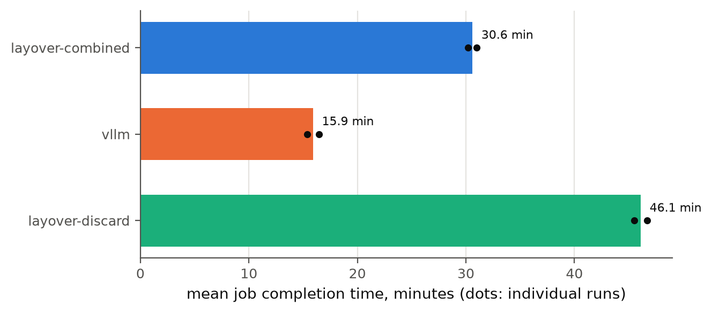
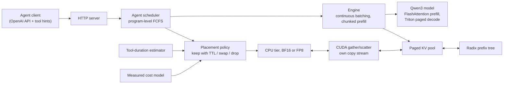
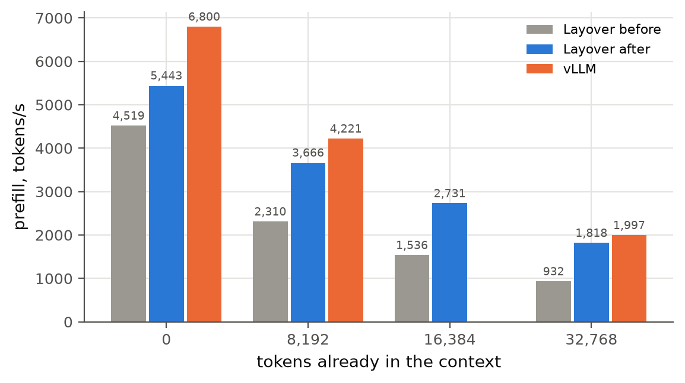
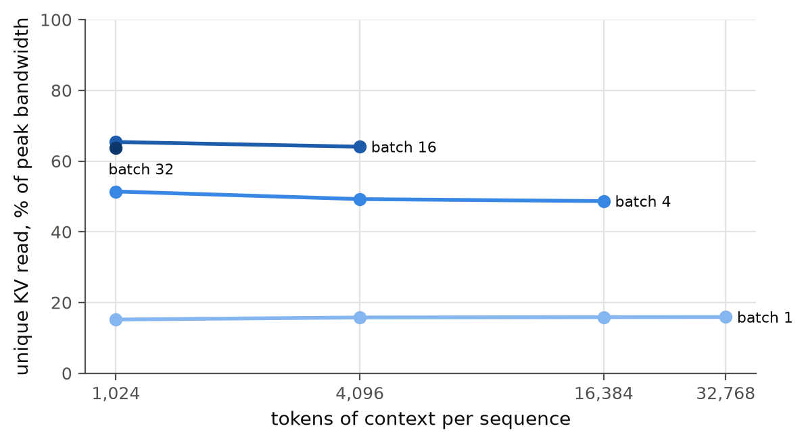
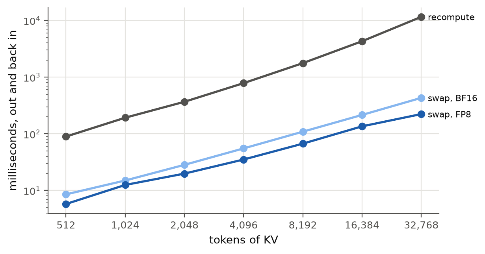

# Layover

An LLM inference engine for AI agents that decides, at each tool call, whether to keep, swap or drop the agent's KV cache.

[](https://github.com/CarlGergi/Layover/actions/workflows/ci.yml)




*Mean job time on 15 SWE-bench agent jobs at 0.02 jobs/s on one NVIDIA L4 (bars: mean of 2 runs; dots: each run). Placing KV per tool call cuts job time by a third against always dropping it, on the same engine. vLLM's faster engine still finishes about twice as fast.*

## At a glance

Measured on one NVIDIA L4 (24 GB) with Qwen3-4B in BF16. Intervals are 95% bootstrap intervals over 20 jobs paired by seed and task.

| What | Result |
| --- | --- |
| **Placement policy** vs always dropping KV, same engine | Mean job time **0.66×** (0.65 to 0.68): 30.6 vs 46.1 min |
| **End to end vs vLLM 0.33**, matched memory budgets | Layover's mean job time is **1.92×** vLLM's (1.79 to 2.09) |
| Swapping 8,192 tokens of KV out and back, vs recomputing | 67 ms (FP8) / 109 ms (BF16) vs 1.77 s |
| Prefill after 32k tokens, before vs after profiling fixes | 932 → 1,818 tokens/s (vLLM: 1,997) |
| Custom CUDA and Triton kernels under compute-sanitizer | memcheck 0 errors, racecheck 0 hazards |

## Overview

While an agent waits on a tool (tests, a shell command), its KV cache sits idle in scarce GPU memory. Keeping it blocks other requests; dropping it means recomputing the whole context when the agent returns. Layover decides per tool call: **keep** it with a time limit, **swap** it to CPU memory as FP8, or **drop** it to a prefix tree where it stays reusable until memory pressure takes it. The decision comes from a cost model measured on the GPU it runs on.

## Architecture



| Component | Technology | Why |
| --- | --- | --- |
| Engine (`layover/engine.py`, `model.py`) | PyTorch, FlashAttention | Continuous batching with chunked prefill |
| Paged KV pool (`layover/kv/`) | PyTorch, all layers of a block contiguous | A swap is a few large copies, not thousands of small ones |
| Radix prefix tree (`layover/kv/radix.py`) | Python | Copy-on-write sub-agents; dropped blocks stay reusable |
| Placement policy (`layover/agent/`) | Python | Prices keep, swap and drop in seconds from measured curves |
| Decode attention (`layover/kernels/triton_decode.py`) | Triton | Reads K and V straight from the block table |
| Transfers (`native/transfer_cuda.cu`) | CUDA C++, pinned memory | Gathers scattered blocks and quantizes to FP8 in one kernel |
| Benchmark harness (`bench/`, `scripts/remote_gpu.sh`) | Python, NVML, Bash | Matched budgets, real traces, one-command reproduction on a rented GPU |

## Results

**Conditions.** NVIDIA L4 on RunPod, PyTorch 2.15.0, Triton 3.9.0, vLLM 0.33.0, Qwen3-4B in BF16 with greedy decoding. Every system gets the same 12 GiB KV pool (checked against each server's own report before every run), a 24 GiB CPU tier, at most 32 running requests and 2,048-token prefill chunks. The workload is 15 re-executed SWE-bench agent trajectories (5 warm-up, 10 measured), Poisson arrivals, 2 seeds per system; tool pauses replay measured tool durations.

**Load.** The harness aims for the rate at which vLLM's mean job time reaches 1.5× its unloaded time, but even the lowest rung of its ladder, 0.02 jobs/s, already put vLLM at 3.71×. All systems ran at that rate: heavy load, where KV placement matters most, because evicted KV must come back by swap or by recompute on the GPU everyone is queued for.

| System | Seed | Mean JCT (s) | p95 JCT (s) | Programs/hour | Mean TTFT (s) | Prompt tokens from cache |
| --- | --- | --- | --- | --- | --- | --- |
| layover-combined | 1000 | 1859.1 | 2338.3 | 12.9 | 27.9 | 97.5% |
| layover-combined | 1001 | 1812.9 | 2279.4 | 13.5 | 26.3 | 97.5% |
| layover-discard | 1000 | 2800.9 | 3537.7 | 9.1 | 46.2 | 51.4% |
| layover-discard | 1001 | 2732.1 | 3367.4 | 9.6 | 44.4 | 56.9% |
| vllm | 1000 | 986.8 | 1396.5 | 21.9 | 12.6 | 95.7% |
| vllm | 1001 | 922.2 | 1332.5 | 23.7 | 10.8 | 96.1% |

| Ratio | Mean job time (95% interval) | Programs/hour | Mean TTFT |
| --- | --- | --- | --- |
| **Policy:** layover-combined ÷ layover-discard | **0.66** (0.65 to 0.68) | 1.41 | 0.60 |
| **End to end:** layover-combined ÷ vLLM | **1.92** (1.79 to 2.09) | 0.58 | 2.33 |

The policy comparison is the one the project is about: same engine, budgets, seeds and jobs, and only the decision at a tool call differs. Always dropping brings back only 51 to 57% of prompt tokens from cache, against 97.5% when the policy swaps. vLLM serves about as much from cache, so its lead comes from the engine, not placement. The interval resamples jobs paired across systems; jobs in one run share a server, so it understates run-to-run variation (`bench/report.py` also gives per-seed values).

### Profiling

An Nsight Systems profile of the first GPU run found prefill spending 36% of GPU time in a generic masked attention kernel. Calling FlashAttention directly, with the 4 query heads per KV head folded into the sequence, and removing per-layer host work gave:



*Prefill rate of a 2,048-token chunk after a given context. vLLM was not measured at 16,384.*

| | Prefill after 32k, tokens/s | Decode step, batch 1, 8k context |
| --- | --- | --- |
| Layover before (`589b2b7`) | 932 | 75.8 ms |
| Layover after | 1,818 | 62.4 ms (60.4 ms with CUDA graphs) |
| vLLM 0.33 | 1,997 | 37.4 ms |

CUDA graphs were added on the guess that 2,111 kernel launches per decode step dominated. They saved 3%: the guess was wrong, and they stay because they are tested.

### Decode bandwidth



*Unique KV bytes read per second as a share of the L4's 300 GB/s peak.*

Decode reads every cached K and V once per token, so the kernel is judged by bandwidth. It reaches about 64% of peak at batch 16 to 32 but only 16% at batch 1, the single-agent case: each of the 8 KV heads is read 4 times (once per query head), and 32 programs leave most of the L4's 58 SMs idle.

### Swapping vs recomputing



*Round-trip swap time against recompute time, by context length. These curves are the policy's cost model.*

On the L4, swapping beats recomputing at every length measured, by 15 to 52× (8,192 tokens: 67 ms FP8, 109 ms BF16, 1.77 s recompute). FP8 takes 16 to 48% off the round trip.

## How it's tested

- **Parity:** per-layer and greedy-output parity against Hugging Face `transformers` on Qwen3-0.6B (CPU) and Qwen3-4B (L4), including FlashAttention, fused prefill and CUDA graphs.
- **KV structures and scheduler:** unit and Hypothesis property tests against reference models, on a virtual clock.
- **Kernels:** Triton decode against a PyTorch reference, in Triton's interpreter and compiled on the L4; every custom kernel under compute-sanitizer (`make sanitize`).
- **Benchmarks:** the whole matrix pipeline runs on CPU against stub servers, and a run whose memory budget doesn't match is rejected, not reported.
- **Remote runner:** tested against a stub machine, including its self-stop timers, plus opt-in end-to-end over real SSH.
- **CI:** `ruff check` and the CPU suite on every push, offline. Locally, `make test` gives 1,081 passing and 61 skipped (GPU-only or opt-in).

## Quick start

```bash
uv venv --python 3.12 .venv
uv pip install --python .venv/bin/python -e ".[dev]"
make test
```

Tests run on CPU with a tiny model and Qwen3-0.6B; GPU tests skip unless `--gpu` is passed. To serve on CPU, measure a cost model, then start the OpenAI-compatible server:

```bash
.venv/bin/python bench/kv_crossover.py --model Qwen/Qwen3-0.6B --tokens 64 128 256 512 --out results/cpu
```

```bash
.venv/bin/python -m layover.server --model Qwen/Qwen3-0.6B --cost-model results/cpu/cost_model.json
```

Requests may add `session_id` and a `layover` object (`program_id`, `tool_name`, `expected_tool_s`) to guide placement; `POST /v1/sessions/{id}/fork` starts a copy-on-write sub-agent.

**Reproducing every number** on a Linux machine with a CUDA GPU (crossover curves, bandwidth, the matrix and its report), then the figures:

```bash
make reproduce MATRIX_ARGS="--plan final --max-hours 9.5 --accept-saturation-edge"
```

```bash
make figures RESULTS=results
```

On a rented GPU, `scripts/remote_gpu.sh root@IP -p PORT -i key --runpod --plan final --max-hours 9.5 --accept-saturation-edge --detach` syncs the tree, runs detached, and stops the machine itself when the run ends or its time limit passes. The traces come from a public SWE-bench submission, re-executed in each task's container by `make traces-prepare traces` (`scripts/remote_traces.sh` runs that on a remote machine).

## Limitations and future work

- **The engine is about 1.9× slower than vLLM.** Batch-1 decode takes 62 ms against 37 ms; at 8k tokens attention takes about 25 ms of it because of the 4× KV re-read. Next: one program per KV head, plus split-K for long contexts. Later prefill chunks also copy the history once per layer.
- **One load point, never bracketed**, and 2 runs per system on one GPU type.
- **Not measured** within the $10 GPU budget: SGLang, the single-policy ablations, and the FP8 tier in the full matrix.
- **Workload bias.** Re-execution kept mostly fast tasks and a 32k context cap; tool calls are short, which favors keeping KV. Agents whose tools run for minutes may behave differently.

## Prior work

The keep/swap/drop choice comes from InferCept (ICML 2024), the time-to-live from Continuum (ICLR 2026), and program-level scheduling from Autellix (2025). The design also follows PagedAttention (SOSP 2023), SGLang's RadixAttention (NeurIPS 2024), Orca (OSDI 2022) and Sarathi-Serve (OSDI 2024). No code is taken from these systems.

## License

MIT, copyright Carl Gergi. See [LICENSE](LICENSE).
