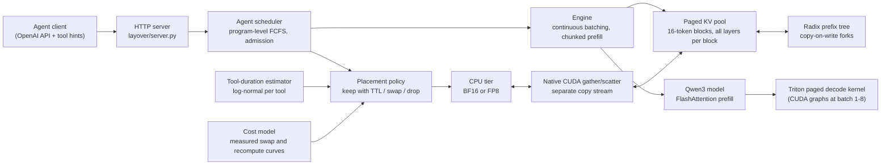

# Layover

An LLM inference engine for AI agents that decides, at each tool call, whether to keep, swap or drop the agent's KV cache.

[](https://github.com/CarlGergi/Layover/actions/workflows/ci.yml)


*Mean job completion time on 15 SWE-bench agent jobs at 0.02 jobs/s on one NVIDIA L4. The bars are the mean of 2 runs, and the dots are the individual runs. Placing KV per tool call (layover-combined) cuts job time by a third against always dropping it (layover-discard) on the same engine. vLLM's faster engine still finishes about twice as fast.*

## At a glance

All numbers were measured on one NVIDIA L4 (24 GB) with Qwen3-4B in BF16. Intervals are 95% bootstrap intervals over 20 jobs, paired by seed and task (see [Results](#results)).

| What | Result |
| --- | --- |
| **Placement policy**: keep/swap/drop per tool call vs always drop, same engine | Mean job time **0.66×** (0.65 to 0.68): 30.6 vs 46.1 min |
| Same comparison, throughput and tail | 13.2 vs 9.4 programs/hour; p95 job time 38.5 vs 57.5 min |
| **End to end vs vLLM 0.33** at matched memory budgets | Layover's mean job time is **1.92×** vLLM's (1.79 to 2.09) |
| Swapping 8,192 tokens of KV out and back, vs recomputing them | 67 ms (FP8) / 109 ms (BF16) vs 1.77 s |
| Prefill of a 2,048-token chunk after 32k tokens, before vs after profiling fixes | 932 → 1,818 tokens/s (vLLM: 1,997) |
| Custom CUDA and Triton kernels under compute-sanitizer | memcheck 0 errors, racecheck 0 hazards |

## Overview

An agent alternates between generating text and waiting on a tool, such as running tests or a shell command. While it waits, its KV cache (the model's memory of the conversation so far) sits idle in scarce GPU memory. A server can keep that KV, which blocks other requests, or drop it and pay to recompute the whole context when the agent returns. Layover makes the choice per tool call:
- **Keep** the KV with a time limit if the tool is expected back soon.
- **Swap** it to CPU memory (as FP8, half the bytes).
- **Drop** it, leaving its blocks reusable in a prefix tree until memory pressure takes them.

The choice comes from a cost model measured on the GPU it runs on. On the same engine and workload, this policy cuts mean job time by 34% against always dropping. The engine underneath is still about 1.9× slower than vLLM, and the profile says why (see [Limitations](#limitations-and-future-work)).

## Architecture



| Component | Technology | Why |
| --- | --- | --- |
| Model and engine (`layover/model.py`, `engine.py`) | PyTorch, FlashAttention through `scaled_dot_product_flash_attention` | Continuous batching with chunked prefill. FlashAttention with causal masking aligned to the end of the history doubled long-context prefill. |
| Paged KV pool (`layover/kv/paged_cache.py`, `allocator.py`) | PyTorch tensors, `[block, kind, layer, head, slot, dim]` | Paging removes fragmentation. Keeping all layers of a block contiguous makes a swap a few large copies instead of thousands of small ones. |
| Radix prefix tree (`layover/kv/radix.py`) | Python, reference counts | Lets sub-agents share prefixes copy-on-write and keeps dropped blocks reusable until memory pressure. Design follows SGLang's RadixAttention. |
| Placement policy and scheduler (`layover/agent/`) | Python | Prices keep, swap and drop in seconds of delay from measured curves. The time-to-live caps the loss from a wrong tool-duration guess. |
| Decode attention (`layover/kernels/triton_decode.py`) | Triton 3.9 | Reads K and V straight from the block table, one query token per sequence. |
| Transfers (`native/transfer_cuda.cu`, `layover/kv/tier.py`) | CUDA C++, pinned memory, its own stream | Gathers scattered blocks and quantizes to FP8 in one kernel, overlapping copies with compute. |
| Decode graphs (`layover/decode_graphs.py`) | CUDA graphs | Replays small-batch decode steps; padded rows write only to a reserved scratch block. |
| Benchmark harness (`bench/`) | Python, NVML, matplotlib | Matched budgets across systems, real agent traces, atomic per-run results, one-command reproduction. |
| Remote runner (`scripts/remote_gpu.sh`) | Bash, SSH, rsync, `runpodctl` | Runs detached on a rented GPU and stops the machine itself when the run ends. |

## Results

### Conditions

| | |
| --- | --- |
| GPU | NVIDIA L4, 24 GB, driver 595.91.07, CUDA 13.2. RunPod Secure Cloud (US-MO-2), 16 vCPU, 87 GiB container memory limit |
| Software | PyTorch 2.15.0, Triton 3.9.0, vLLM 0.33.0 |
| Model | Qwen/Qwen3-4B, BF16, greedy decoding |
| Matched budgets | KV pool 12 GiB (87,376 tokens, checked against each server's own report before every run), CPU tier 24 GiB, at most 32 running requests, 2,048-token prefill chunks |
| Workload | 15 jobs from re-executed SWE-bench agent trajectories (see [Traces](#traces)), the first 5 as warm-up, 10 measured. Poisson arrivals, 2 seeds (1000, 1001) per system. Tool pauses replay the measured tool durations, so every system waits exactly as long. |
| Load | A fixed arrival rate of **0.02 jobs/s** (see below) |

**About the load.** The harness calibrates load on vLLM, the baseline: "100% load" is meant to be the arrival rate at which vLLM's mean job time reaches 1.5× its unloaded time (275 s). The calibration ladder never got that low. At its lowest rung, 0.02 jobs/s, vLLM already ran at 3.71× its unloaded time (4.05× at 0.025, 4.65× at 0.03). So every system ran at that fixed 0.02 jobs/s, below the calibrated ladder, where vLLM's jobs take about 3 to 4 times as long as they would alone. Every output of the run says the rate was not bracketed.

That is a heavy-load regime, and it is the one where KV placement matters most. At light load, every paused agent's KV fits in GPU memory, so keeping all of it costs nothing and every policy performs the same. At heavy load, a paused agent's KV competes for the pool with the turns that are running. Whatever is evicted has to come back by swap or by recompute, and recompute spends time on the GPU, the very resource the queue is waiting for. A wrong placement then delays everyone behind it.

### The six runs

| System | Seed | Mean JCT (s) | p95 JCT (s) | Programs/hour | Mean time to first token (s) | Prompt tokens served from cache | PCIe moved (GB, NVML estimate) |
| --- | --- | --- | --- | --- | --- | --- | --- |
| layover-combined | 1000 | 1859.1 | 2338.3 | 12.9 | 27.9 | 97.5% | 815 |
| layover-combined | 1001 | 1812.9 | 2279.4 | 13.5 | 26.3 | 97.5% | 703 |
| layover-discard | 1000 | 2800.9 | 3537.7 | 9.1 | 46.2 | 51.4% | 43 |
| layover-discard | 1001 | 2732.1 | 3367.4 | 9.6 | 44.4 | 56.9% | 38 |
| vllm | 1000 | 986.8 | 1396.5 | 21.9 | 12.6 | 95.7% | 1093 |
| vllm | 1001 | 922.2 | 1332.5 | 23.7 | 10.8 | 96.1% | 1066 |

JCT is job completion time. With 10 measured jobs, p95 is the slowest job.

### Policy: layover-combined vs layover-discard

This is the comparison the project is about. Both rows run the same engine, kernels, budgets, seeds and jobs. Only the placement decision at a tool call differs: layover-combined keeps, swaps or drops by the cost model, and layover-discard always drops. It still keeps whole blocks reusable in the prefix tree until memory pressure takes them, as vLLM does.

| Measure (combined ÷ discard) | Ratio | 95% interval |
| --- | --- | --- |
| Mean job time | 0.66 | 0.65 to 0.68 |
| p95 job time (median of per-seed ratios) | 0.67 | per-seed: 0.66, 0.68 |
| Programs per hour | 1.41 | per-seed: 1.41, 1.40 |
| Mean time to first token | 0.60 | per-seed: 0.60, 0.59 |

Under memory pressure, dropping loses about half the cached context: only 51 to 57% of prompt tokens come back from cache, against 97.5% when the policy swaps. The swapped bytes show on PCIe (about 760 GB per run vs about 40 GB).

### End to end: Layover vs vLLM

| Measure (Layover ÷ vLLM) | Ratio | 95% interval |
| --- | --- | --- |
| Mean job time | 1.92 | 1.79 to 2.09 |
| Programs per hour | 0.58 | per-seed: 0.59, 0.57 |
| Mean time to first token | 2.33 | per-seed: 2.21, 2.45 |

vLLM serves nearly as much context from cache (about 96%, through its prefix cache and CPU offloading), so the gap comes from the engine rather than placement. The profile below shows where: batch-1 decode steps take 62 ms against vLLM's 37 ms, and prefill is 10 to 20% slower.

How the intervals are computed: the interval resamples the 20 measured jobs (10 per seed), each job paired with the same job on the other system. Jobs in one run share a server, so they are not independent, and this interval is narrower than one across many runs would be. With 2 runs per system, the per-seed values are given beside it. `bench/report.py` writes both into `report.md`.

### Profiling: before and after

The first GPU run showed prefill about 10× slower than planned. An Nsight Systems profile ranked where GPU time went:

1. **Masked memory-efficient attention, 36% of GPU time.** Prefill used a generic masked kernel. Fixed by calling FlashAttention directly with causal masking aligned to the end of the history, and by folding the 4 query heads that share a KV head into the sequence instead of copying K and V four times.
2. **GEMMs, about 33%.** The model's matrix multiplies. Not changed.
3. **The paged decode kernel, 80% of decode GPU time at batch 32.** Bound by memory bandwidth; see the next section.

Host-side fixes landed at the same time:
- the decode batch is checked and copied to the GPU once per step instead of once per layer;
- the kernel reads nothing back to the CPU inside a step;
- block ids are built once per prefill chunk;
- one argmax transfer per decode step.


*Prefill rate of a 2,048-token chunk after a given context on the L4. vLLM was not measured at 16,384.*

| Prefill, tokens/s | Context 0 | 8,192 | 16,384 | 32,768 |
| --- | --- | --- | --- | --- |
| Layover before (`589b2b7`) | 4,519 | 2,310 | 1,536 | 932 |
| Layover after | 5,443 | 3,666 | 2,731 | 1,818 |
| vLLM 0.33 | 6,800 | 4,221 | not measured | 1,997 |

| Decode step at 8,192 tokens of context, ms | Batch 1 | Batch 8 | Batch 32 |
| --- | --- | --- | --- |
| Layover before (`589b2b7`) | 75.8 | 99.3 | 231.8 |
| Layover after | 62.4 | 77.0 | 176.4 |
| Layover after, with CUDA graphs (batch 1 to 8) | 60.4 | | |
| vLLM 0.33 | 37.4 | 79.8 | not measured |

CUDA graphs were added on the hypothesis that the 2,111 kernel launches in a batch-1 decode step dominated. They barely helped (62.3 → 60.4 ms, measured back to back) because the GPU itself stays busy. They are kept, with parity tests, but the hypothesis was wrong.

### Decode attention bandwidth

Decode is bound by memory bandwidth: each generated token reads every cached K and V once. So the kernel is judged by bytes per second against the L4's 300 GB/s peak (a roofline argument), not by FLOPs.


*Unique KV bytes read per second as a share of the L4's 300 GB/s peak, counting each byte once.*

| Batch | Unique KV read, % of peak |
| --- | --- |
| 1 | 15 to 16% (about 47 GB/s), flat from 1k to 32k tokens |
| 4 | 49 to 51% |
| 16 | 64 to 65% |
| 32 | 64% |

Batch 1 is low for two reasons:
- Qwen3-4B's 32 query heads share 8 KV heads, and the kernel gives each query head its own program, so each KV head is read 4 times. Counting the repeats, batch 1 reaches 63% of peak.
- At batch 1 there are only 32 programs for the L4's 58 SMs.

Batch 1 is the agent case, since a single agent decodes alone. At 8,192 tokens the kernel takes about 25 ms of a 62 ms batch-1 step, so the 4× re-read is the largest single cost in decode.

### Swapping vs recomputing


*Round-trip swap time against recompute time on the L4, by context length. These curves are the cost model the policy uses.*

| Tokens | Swap, FP8 | Swap, BF16 | Recompute |
| --- | --- | --- | --- |
| 512 | 5.8 ms | 8.5 ms | 89 ms |
| 8,192 | 67 ms | 109 ms | 1.77 s |
| 32,768 | 223 ms | 431 ms | 11.6 s |

On this card swapping beats recomputing at every length measured, by 15 to 52×. FP8 halves the bytes crossing PCIe and takes 16 to 48% off the round trip (more at longer contexts).

**Gathering scattered blocks** (`make transfer-gather`), at 1,024 shuffled blocks:
- **BF16:** one gather kernel plus one copy each way moves 19 to 20 GiB/s. That is no faster than one copy per block (21 GiB/s), because a block holds all 36 layers (2.25 MiB) and a single block copy already saturates PCIe.
- **FP8:** the gather wins, 58 ms out against 67 ms, because it quantizes in the same kernel.

## How it's tested

| Layer | How | Numbers |
| --- | --- | --- |
| Model and engine | Per-layer and greedy-output parity against Hugging Face `transformers` on Qwen3-0.6B (CPU), and on Qwen3-4B on the L4 | All passing; FlashAttention, fused-prefill and CUDA-graph parity on the GPU |
| KV structures and policy | Unit and property tests (Hypothesis) of allocator, radix tree, copy-on-write forks and scheduler, on a virtual clock | Fuzzed against reference models of each structure |
| Kernels | Triton decode against a PyTorch reference: in Triton's interpreter on Linux (`make test-docker`) and compiled on the L4. CUDA transfers against the host build. | Every custom kernel under compute-sanitizer: **memcheck 0 errors, racecheck 0 hazards** (`make sanitize`) |
| Benchmarks | The whole matrix pipeline runs on CPU against stub servers, and every published number comes from `make reproduce` | GPU smoke on the L4: 10 of 10 checks passed (reference parity, Triton decode, native transfer, server session, GPU tests) before any matrix time was spent |
| Remote runner | Tests against a stub machine, including the self-stop timers; end-to-end over real SSH into a container with `LAYOVER_DOCKER_E2E=1` | 243 passing, 10 end-to-end opt-in |
| Continuous integration | GitHub Actions on every push: `ruff check` and the CPU suite on Linux with Triton's interpreter, offline (tests that download weights are skipped) | `.github/workflows/ci.yml` |
| Whole suite on a Mac | `make test` | 1,081 passing; 61 skipped (GPU-only or opt-in end-to-end) |

Before a run is accepted, every server's KV pool, GPU memory and CPU tier are read back from the server itself and checked against the matched budget. A run that is off budget fails rather than being reported.

## Quick start

```bash
uv venv --python 3.12 .venv
uv pip install --python .venv/bin/python -e ".[dev]"
make test
```

Tests run on CPU with a tiny random-weight model and with real Qwen3-0.6B weights, which download on first use. GPU-only tests are marked and skip unless `--gpu` is passed. Triton has no macOS wheels, so `make docker-image test-docker` runs the same suite on Linux, where the kernels run in Triton's interpreter.

To serve a model on CPU, first produce a cost model:

```bash
.venv/bin/python bench/kv_crossover.py --model Qwen/Qwen3-0.6B --tokens 64 128 256 512 --out results/cpu
```

Then start the server:

```bash
.venv/bin/python -m layover.server --model Qwen/Qwen3-0.6B --cost-model results/cpu/cost_model.json
```

### Reproducing every number

On a Linux machine with a CUDA GPU and the re-executed trace, this one command regenerates the crossover curves (BF16 and FP8), decode bandwidth, transfer gather, matrix preflight, the matrix and its report:

```bash
make reproduce MATRIX_ARGS="--plan final --max-hours 9.5 --accept-saturation-edge"
```

`--accept-saturation-edge` is what this run needed: when calibration cannot bracket vLLM's saturation rate, the matrix runs at the ladder's edge instead of stopping, and every output says so. A re-run keeps complete measurements (`FORCE=1` re-measures), because a new cost model would invalidate saved runs. Then the figures:

```bash
make figures RESULTS=results
```

The profiling numbers come from `make profile` (and `bench/profile_hot_path.py --system vllm`).

### Running on a rented GPU

`scripts/remote_gpu.sh` syncs the tree over SSH, starts the run detached, and returns, so nothing on your side needs to stay awake. `--status` checks in, and `--fetch-only` copies `results/` back. The machine runs setup and a short GPU smoke stage first, so a broken setup costs minutes.

```bash
scripts/remote_gpu.sh root@IP -p PORT -i key --runpod --plan final --max-hours 9.5 --accept-saturation-edge --detach
```

The machine never bills idle:
- When its run ends (finished, over budget, or after 3 failed matrix cells in a row), it stops itself a minute later.
- A timer set at the start stops it regardless after `--max-session-hours`.
- On RunPod, where `shutdown` does nothing in a container, the pod stops itself with `runpodctl stop pod` and the API key RunPod gives each pod.

A stopped pod still bills for its disk, so delete it once the results are back. The SSH port changes on every restart. On AWS, keep the instance's shutdown behavior at Stop. Each finished run is written atomically and kept, so a re-run resumes.

### Benchmark plans

`bench/run_matrix.py --plan NAME` selects one, and `--dry-run` prices it.

| Plan | Runs |
| --- | --- |
| `final` (default, the one measured here) | `layover-combined`, `vllm`, `layover-discard`, 2 runs each, first 15 tasks, CPU tier 24 GiB |
| `final-ablations` | `final` plus `layover-keep_ttl` and `layover-swap`, 2 runs each (not run: budget) |
| `runpod-l4` | `layover-combined` and `vllm` at 100% and 125% load, 3 runs each, then `sglang`, then the ablations |
| `under-20h`, `first-pass`, `three-loads-lean`, `full` | Larger plans with more loads, runs and SGLang |

Settings, flags, and the remaining differences between systems are in `bench/configs/baseline_flags.md`.

### API

`POST /v1/chat/completions` and `POST /v1/completions` follow the OpenAI API. Prompts may be token ids. Decoding is greedy. These extra body fields are optional:

```json
{
  "session_id": "agent-1",
  "layover": {"program_id": "job-7", "tool_name": "run_tests", "expected_tool_s": 12.0, "end_session": false}
}
```

The tool name is also read from the model's own `<tool_call>` output. Other endpoints:
- `POST /v1/sessions/{id}/fork` starts a sub-agent that shares its parent's KV copy-on-write.
- `DELETE /v1/sessions/{id}` frees a session.
- `GET /metrics` reports placements and memory.

## Traces

The headline benchmark uses real agent trajectories: 30 tasks from a public [SWE-bench](https://github.com/SWE-bench/experiments) submission (`20260217_mini-v2.0.0_minimax-2-5-high`, a [mini-swe-agent](https://github.com/SWE-agent/mini-swe-agent) run).

1. `make traces-prepare` picks the tasks with a fixed seed and counts each turn's tokens with the Qwen3-4B tokenizer. Tasks over 32,768 tokens of context are excluded (20% of those walked), which skews the workload shorter.
2. `make traces` re-executes each trajectory's commands inside the task's container, because a submitter's recorded gaps come from an unknown machine. A task counts only if:
   - at least 90% of its comparable return codes match;
   - its final patch matches;
   - output similarity reaches 0.5.

   Fidelity of the final set: median return-code match 1.00, median output similarity 0.93, and 30 of 30 patches matched.

The published trace was re-executed on a plain x86 machine with Docker and no GPU (an AWS `m7i-flex.large`), with `scripts/remote_traces.sh user@host -i key` (`--status`, then `--fetch`); the machine shuts itself down 4 hours after the start whatever happens.

**Selection effect.** Re-execution replaced 9 of the first 30 tasks, mostly the slow ones. The selected set's recorded tool time fell from 2,299 s to 1,516 s, and re-executed it spends 480 s in tools over 1,272 turns. About 54% of that is install and download commands. Short tool calls favor keeping KV over swapping or dropping it, so these results say little about agents whose tools run for minutes.

The matrix replays the first 15 tasks. Synthetic traces (`python -m layover.replay generate`) exist only for parameter sweeps.

## Limitations and future work

- **The engine is about 1.9× slower than vLLM end to end.** The profile names the causes, in order:
  - **Batch-1 decode is 62 ms against vLLM's 37 ms.** At 8k tokens the attention kernel takes about 25 ms of it (measured), because it re-reads each KV head 4 times (grouped-query attention) and runs only 32 programs on 58 SMs. Reading the 8 GB of BF16 weights takes at least 27 ms at the L4's peak, so the rest of the step is near its floor. Fix: one program per KV head covering its 4 query heads, which would cut the reads 4×, plus split-K (flash-decoding) for long sequences.
  - **Later prefill chunks gather the history once per layer.** A paged prefill kernel that reads history in place would remove the copy.
- **CUDA graphs gave 3%.** They were built on a wrong hypothesis (launch overhead) and kept because they are tested and harmless.
- **One load point, never bracketed.** vLLM was already past 1.5× its unloaded time at the lowest rung, so the matrix ran at that edge (0.02 jobs/s) rather than at a calibrated 100% load. Lighter load would show smaller differences between policies.
- **Few runs.** 2 runs per system on 15 jobs (10 measured), on one GPU type. The job-level intervals understate run-to-run variation.
- **Not measured, because the whole GPU budget was $10:**
  - **SGLang:** the matrix code supports it, and the larger plans include it.
  - **The single-policy ablations** (`keep_ttl`, `swap`).
  - **The FP8 vs BF16 tier in the matrix:** only its transfer cost was measured.
- **Workload bias.** Short tool calls and the 32k context cap make the workload lighter than the submission it comes from.

## Prior work

InferCept (Abhyankar et al., ICML 2024) introduced the preserve, swap or discard choice. Continuum (Li et al., ICLR 2026) pins KV with a time-to-live, and Autellix (Luo et al., 2025) schedules at the program level. Several designs follow earlier work:
- the paged KV layout follows Kwon et al. (SOSP 2023);
- the prefix tree follows SGLang's RadixAttention (Zheng et al., NeurIPS 2024);
- continuous batching follows Orca (Yu et al., OSDI 2022);
- chunked prefill follows Sarathi-Serve (Agrawal et al., OSDI 2024).

No code is taken from these systems.

## License

MIT, copyright Carl Gergi. See [LICENSE](LICENSE).
